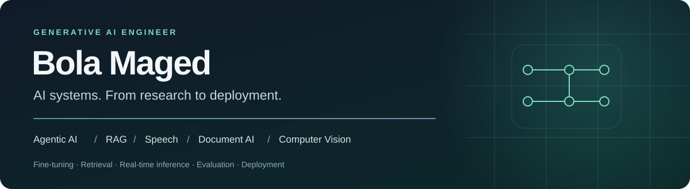

I'm **Bola Maged Ramses Nessim**, a **Generative AI Engineer with 1.5 years of hands-on experience** building and deploying AI systems across agents, retrieval, speech, document understanding, and computer vision.

My work spans the full pipeline: preparing data, adapting models, designing agent workflows, connecting tools and databases, evaluating behavior, and deploying the application. I care about response quality, latency, GPU memory, and how a system recovers when something fails.

[LinkedIn](https://www.linkedin.com/in/bola-maged-012a3b425/) · [Public repositories](https://github.com/bmaged23?tab=repositories) · [Speech-to-speech demo](https://bmaged23.github.io/linguabridge-en-de-sts/demo.html?v=2) · [Multi-agent RAG demo](https://bmaged23.github.io/Fitness_multiagent_RAG/demo.html)

## What I work on

| Area | Hands-on work |
| --- | --- |
| **Agentic AI & RAG** | Multi-agent orchestration, query decomposition, semantic retrieval, web-search agents, database tools, human-in-the-loop validation, and persistent context. |
| **Multilingual speech AI** | End-to-end voice agents, Arabic/Emirati ASR and TTS adaptation, English/German speech-to-speech systems, streaming responses, interruption handling, and latency optimization. |
| **Document & multimodal AI** | Ingestion across PDFs, Word, Excel and images; vision-language models; table extraction and cell-level segmentation for retrieval-ready content. |
| **Model adaptation** | LLM, speech and vision fine-tuning; LoRA, 4-bit quantization, efficient inference, and comparison of model quality against compute requirements. |
| **Computer vision** | Face recognition, attendance workflows, facial landmarks, attention tracking, and active-speaker detection using temporal models and vision-language models. |
| **Engineering & deployment** | FastAPI services, Docker, Kubernetes, CI/CD, model serving, and tracing agent/model behavior with LangSmith. |

These areas include professional and independent work. The repositories below are selected **public examples**; they do not represent every project I've worked on.

## Selected public projects

<table>
<tr>
<td width="50%" valign="top">
<h3><a href="https://github.com/bmaged23/Fitness_multiagent_RAG">Fitness Multi-Agent RAG</a></h3>

A conversational coaching application with cooperating agents, retrieval-grounded workout planning, persistent context, nutrition tools, voice interaction, and PDF exports.

<strong>Deep Agents / LangGraph · Qdrant · Streamlit</strong>

<a href="https://bmaged23.github.io/Fitness_multiagent_RAG/demo.html">Watch demo</a> · <a href="https://github.com/bmaged23/Fitness_multiagent_RAG">Explore code</a>

</td>
<td width="50%" valign="top">
<h3><a href="https://github.com/bmaged23/MarketDeepAgent">Market Deep Agent</a></h3>

An agentic market-research assistant using multi-step planning, delegated research, and structured report generation.

<strong>DeepAgents · Tool use · Research workflows</strong>

<a href="https://github.com/bmaged23/MarketDeepAgent">Explore project</a>

</td>
</tr>
<tr>
<td width="50%" valign="top">
<h3><a href="https://github.com/bmaged23/linguabridge-en-de-sts">LinguaBridge STS</a></h3>

English–German speech-to-speech translation and conversation with local GPU recognition/synthesis, a streaming cloud LLM, persistent memory, and voice interruptions.

<strong>Qwen ASR · Ollama Cloud · Kokoro / Piper</strong>

<a href="https://bmaged23.github.io/linguabridge-en-de-sts/demo.html?v=2">Watch demo</a> · <a href="https://github.com/bmaged23/linguabridge-en-de-sts">Explore code</a>

</td>
<td width="50%" valign="top">
<h3><a href="https://github.com/bmaged23/train-rnn-asd">Active-Speaker Detection</a></h3>

Visual-only speaking detection from face sequences, exploring landmark BiLSTM, image CNN+LSTM, and adapted vision-language approaches with held-out evaluation.

<strong>PyTorch · MediaPipe · Temporal models · VLMs</strong>

<a href="https://github.com/bmaged23/train-rnn-asd">Explore experiments</a>

</td>
</tr>
<tr>
<td width="50%" valign="top">
<h3><a href="https://github.com/bmaged23/face-recognition-attendance">Face Recognition & Attendance</a></h3>

GPU face recognition for video and live-camera input, with face enrollment and optional check-in/check-out attendance workflows.

<strong>AdaFace · Python · Computer vision</strong>

<a href="https://github.com/bmaged23/face-recognition-attendance">Explore project</a>

</td>
<td width="50%" valign="top">
<h3><a href="https://github.com/bmaged23/multi-person-attention-tracking">Multi-Person Attention Tracking</a></h3>

Multi-person visual attention tracking using object detection, facial landmarks, track association, and annotated video output.

<strong>YOLO · MediaPipe · Video processing</strong>

<a href="https://github.com/bmaged23/multi-person-attention-tracking">Explore project</a>

</td>
</tr>
</table>

Also: [Voca — English voice conversation](https://github.com/bmaged23/voice-conversation) · [Live demo](https://bmaged23.github.io/voice-conversation/demo.html)

## Tools I use

| Focus | Tools |
| --- | --- |
| Agents, retrieval & observability | LangGraph, LangChain, DeepAgents, LangSmith, Qdrant, FAISS, MCP |
| Models & learning | Python, PyTorch, TensorFlow, Hugging Face, LoRA, quantization, vLLM |
| Speech & vision | NeMo, Whisper, Qwen, Kokoro, Piper, OpenCV, YOLO, MediaPipe |
| Applications & infrastructure | FastAPI, React, Streamlit, Docker, Kubernetes, Linux, Git, CI/CD |
| Data & storage | NumPy, Pandas, scikit-learn, PostgreSQL, MySQL, SQLite |

## Background

**B.Sc. in Artificial Intelligence — Cairo University, 2025.** Earlier experience includes a Machine Learning Data Analyst internship at NTI and completion of the DEPI Generative AI / AI & Data Science track.

I enjoy turning research ideas into useful applications and comparing approaches through experiments, resource measurements, and working demos.

For professional conversations and collaboration, connect with me on [LinkedIn](https://www.linkedin.com/in/bola-maged-012a3b425/).
